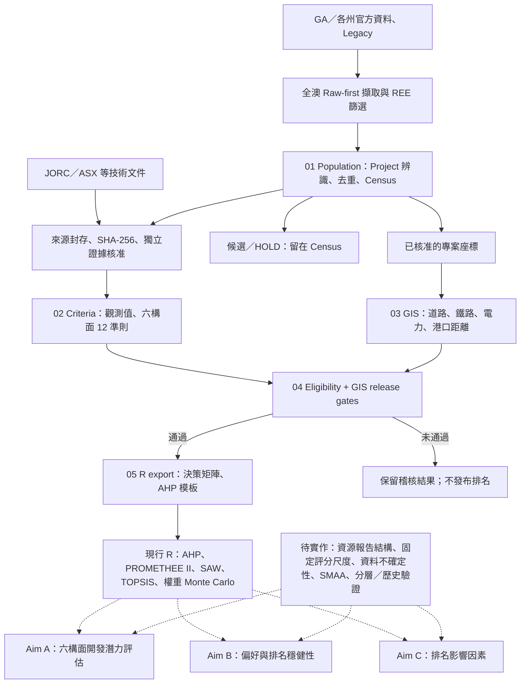

# Australian REE — Project Database & MCDA

可重現的**澳洲稀土礦業專案資料庫**及多準則決策分析（MCDA）研究。以官方礦產資料、技術報告與 GIS 為證據，評估開發潛力、排名穩健性及影響因素。使用 Python 3.11+、SQLite、R，並以 Git/快照維持可追溯性。

## 研究目標

| Aim | 研究問題 |
| --- | --- |
| **A — Development Potential** | 各專案的資源、稀土組成、技術、開發、基礎設施與商業條件如何？ |
| **B — Ranking Robustness** | 決策偏好、數據不確定性及 MCDA 方法會如何影響優先順序？ |
| **C — Ranking Drivers** | 哪些準則、礦床類型及開發階段與排名差異有關？ |

**後續研究一律以 [Research Architecture v2.0](docs/RESEARCH_ARCHITECTURE.md) 為總規格**，配合 [Data Specification](docs/DATA_SPECIFICATION.md)、[MCDA Protocol](docs/MCDA_PROTOCOL.md)、[Validation Protocol](docs/VALIDATION_PROTOCOL.md) 定義 Cohort、資料與統計設計；實作次序、驗收與 PR 規範見 [Research Implementation Plan](docs/RESEARCH_IMPLEMENTATION_PLAN.md)。既有程式為 v1 baseline，**v2 架構已寫入規格、尚未實作或發布正式六構面排名**。

## 研究架構（現行管線與研究目標）



實線表示已建立的資料／程式處理關係；虛線表示**研究目標及待補強的方法**，不代表已完成研究級成果。六構面為 Resource、Strategic Composition、Technical、Development、Infrastructure、Commercial/ESG；正式比較仍受獨立證據核准與 release gate 限制。
## 進度（截至 2026-10-30）

- **現有管線**：五階段 `population → criteria → gis → eligibility → r_export`；R 支援 AHP、PROMETHEE II、SAW、TOPSIS 與**權重** Monte Carlo。
- **全澳來源快照**：123,323 筆政府來源紀錄、1,006 筆 REE 篩選候選。兩者均**不代表獨立、已核准的 REE Project 數量**。
- **487 筆追溯審閱**：最新記錄為 69 筆候選、6 筆 REE 角色待查、412 筆身分／REE 證據不足，仍未形成正式 MCDA 項目清單。
- **待實作**：Project–Deposit–Resource 關聯、SMAA 資料不確定性、六構面共同評分、Aim C 影響因素與歷史回測。**未發布研究級正式排名**。

詳見 [Census release](CENSUS_RELEASE.md) 與 [資料／研究文件索引](docs/README.md)。

## 專案評估（依目前儲存庫與發布快照）

| 面向 | 判斷 | 下一個關鍵工作 |
| --- | --- | --- |
| **方法學** | A/B/C 研究問題、六構面和 MCDA 演算法已有完整架構；正式比較尚缺共同的六構面母體、固定尺度與資料不確定性 | 凍結準則／權重、檢查指標依賴與 Lifecycle Stage 重複計分 |
| **資料整理** | 官方 Raw-first、來源雜湊、證據審查及 Census 快照可追溯；Project 身分及企業／礦權關聯仍待大量核准 | 完成 Project–Deposit–Resource 關聯、來源核准與可比 JORC 數據 |
| **進度** | 資料擷取、重現性管線及合成 MCDA 測試已有成果；正式 Alternatives、研究級評分及 A/B/C 實證結果尚未發布 | 先建立可核准的 RS 六構面比較母體，再推進 SMAA 與 Drivers 分析 |

上述為**研究完成度的質性判斷**，不等於以未核准資料估算的量化進度。詳細依據與修正優先序見 [方法學、資料與進度評估](docs/PROJECT_ASSESSMENT_2026-10-30.md)。
## 後續研究／腳本修改原則

1. **先完成設計 Gate，再改程式**：C1 母體及六構面固定準則 → Project–Deposit–Resource/Evidence schema → utility/AHP → SMAA/Drivers → Historical。
2. 每次 PR 標示對應的 **Aim、P0–P3 Gate、資料/方法版本、測試與變更決策**；使用 [PR Template](.github/pull_request_template.md)。 開發進度統一記錄於 [Research v2.0 P0–P3 工作追蹤](https://github.com/lleeoo0611-stack/AU_REE/issues/14)。
3. 研究參數尚未定稿時，先更新 [Research Decisions](docs/RESEARCH_DECISIONS.md) 與 Protocol，再以獨立 PR 實作；不得改寫舊有研究快照或將候選 Project 直接納入正式 MCDA。

### P0 — 下一階段研究設計（2026-10-31）

已建立 [C1 納入審查規則](docs/P0_COHORT_SELECTION_PROTOCOL.md)、[Project–Deposit–JORC Schema](docs/P0_PROJECT_RESOURCE_SCHEMA.md) 和 [39 群組資料盤點](docs/audits/P0_C1_READINESS_2026-10-31.md)；[逐群組可編輯審查 CSV](docs/audits/2026-10-31_c1_review_groups.csv) 與 JORC/Project Review 表單供後續填寫。**本階段僅完成方法／資料盤點，C1 尚未核准、v2 資料庫 migration 尚未實作。**

### P0.1 — 39 個 Project 群組來源篩查（2026-10-31）

[逐案核查結果與分布](docs/audits/2026-10-31_project_source_screen_report.md) · [39 個 Project 審查 CSV](docs/audits/2026-10-31_project_source_screen_39.csv) · [來源與分類 Manifest](docs/audits/2026-10-31_project_source_screen_39.manifest.json)。39 組按州別為 VIC 11、SA 7、QLD 7、NSW 6、NT 3、WA 3、TAS 2；7 組具已公開研究階段證據、8 組需確認 Study／FID、14 組資源/勘探層級、7 組 REE role HOLD、2 組已超出 pre-FID、1 組暫停。**以上屬來源篩查，正式 C1 尚未核准。**

### P0.1 — 487 筆來源全量批次整合（2026-10-31）

已將原 **487 筆 source targets** 一次整合為可重跑的 [逐筆審查 CSV](docs/audits/2026-10-31_census_487_batch_review.csv)（來源 ID、entity type、Project linkage、證據定位、Tenement/Company 核查、優先工作、C1 Gate）；[完整分布與方法報告](docs/audits/2026-10-31_census_487_batch_review_report.md) · [機器可讀 QA 統計](docs/audits/2026-10-31_census_487_batch_review_summary.json)。487 筆包括 323 Deposit、102 Occurrence、50 Project source records、6 Historical、6 Prospect；**78 筆連結 39 個審閱群組，409 筆未連結**。這是完整的 **source-level inventory audit**，不等於 487 個獨立 Project 已驗證；**正式 C1 及 MCDA 排名尚未核准**。批次更新程式：[scripts/build_p0_census_487_audit.py](scripts/build_p0_census_487_audit.py)。

### P0.1 — 487 筆證據主張審查（2026-10-31）

[完整證據審查報告](docs/audits/2026-10-31_487_evidence_review_report.md) · [487 筆證據核對 CSV](docs/audits/2026-10-31_487_evidence_claim_review.csv) · [來源品質統計](docs/audits/2026-10-31_487_evidence_claim_summary.json)。整合原始 441 筆來源追溯、95 筆既有文件定位及西澳政府 20 個 REE 資源清單項目；另記錄 NT Plenty River → Bruce Project 的 Prospect/Project 文字證據。**所有來源仍需獨立核准才能進入 C1，未改動原有正式排名。** 可重跑：[scripts/review_p0_487_evidence.py](scripts/review_p0_487_evidence.py)。

### P0.1 — 487 筆證據複核（第二輪，2026-10-31）

在保留全部 487 個來源 ID 與原始審查結論下，[第二輪證據報告](docs/audits/2026-10-31_evidence_round2_report.md)與[完整可編輯 CSV](docs/audits/2026-10-31_487_evidence_round2_review.csv)補入 **86 筆外部來源線索**：僅有原生資料 336→272、缺原生資料且無文件定位 23→3；原生 ID 歧義 2 筆已有官方背景，**仍須辨識原始 4／6 筆 feature rows**。提供[86 筆異動紀錄](docs/audits/2026-10-31_evidence_round2_changed_targets.csv)、[可重跑腳本](scripts/review_p0_evidence_round2.py)與[來源定位表](inputs/source_review_20261031/round2_external_evidence_leads.csv)。仍未發布正式 C1。

### P0 — 原始政府資料復原（2026-10-31）

[政府原始資料審查報告](docs/audits/2026-10-31_original_archive_recovery_report.md) · [272 筆原生來源](docs/audits/2026-10-31_272_native_project_scope_triage.csv) · [23 筆原始來源恢復](docs/audits/2026-10-31_23_native_source_recovery.csv) · [南澳 10 筆 feature 身分核對](docs/audits/2026-10-31_sa_10_duplicate_source_features.csv) · [6 筆 Project parent 候選](docs/audits/2026-10-31_272_project_parent_candidates_6.csv)。從 GitHub Actions 的 2026-10-29 原始政府封存核對 272/272 native source records；GA 7 筆恢復 JSON bytes、Legacy 16 筆恢復原始歷史列（原始 `project_id` 與現行 Legacy UUID 一致）。Olympic Dam／Clarke 的 4／6 筆來源列已區分，不重複計為礦床／Project。**所有 C1/JORC/GIS 核准維持不變。**

### P0 — 原生恢復與 Project 父子歸屬（2026-10-31，第三輪）

[第三輪完整研究報告](docs/audits/2026-10-31_p0_native_parent_resolution_report.md) · [272 筆 Project parent 證據表](docs/audits/2026-10-31_272_project_parent_evidence_queue.csv) · [23 筆已實際恢復來源紀錄](docs/audits/2026-10-31_23_original_native_bytes_verified.csv) · [SA 10 筆唯一複合識別碼](docs/audits/2026-10-31_sa_10_compound_feature_keys.csv) · [原始 GA/SA 位元組](data/raw_snapshots/2026-10-29/)。

以 2026-10-29 全澳政府原始快照實際回查，**272/272 唯一 source-native feature、23/23 原生來源位元組驗證、兩個 SA 礦床 ID 的 10 筆 OBJECTID 唯一化**。在 272 個來源列中找到 **15 筆具 REE Project/勘探歸屬候選、4 筆已知非 REE Project**；其餘分為 92 個非 Project 地質圖徵、2 個上層 Deposit、3 個主題類別、156 個缺 Project 母層。以上不是獨立 Project 個數，**C1 仍待核准**。

### P0 第四輪：156 筆 Project 母層證據審查（2026-10-31）

[完整審查報告](docs/audits/2026-10-31_156_project_parent_review_report.md) · [156 筆逐列 CSV](docs/audits/2026-10-31_156_project_parent_evidence_review.csv) · [148 筆待補 Project 關係](docs/audits/2026-10-31_156_project_parent_gaps.csv) · [摘要與來源 SHA](docs/audits/2026-10-31_156_project_parent_evidence_summary.json)。保留政府原始 source feature 與來源稽核，新增 **8 筆具名 Project 文件候選、3 筆名稱／範圍待查**；145 筆仍無新增 Project 文獻，70 筆有跨來源同州同名線索。**來源具名 ≠ 獨立 REE Project 核准；全部 C1 維持 NO。**

### P0 第五輪：109 筆 Project 母層證據審查（2026-10-31）

[109 筆逐列原始來源與外部文件審核](docs/audits/2026-10-31_109_project_evidence_review.csv) · [完整研究報告](docs/audits/2026-10-31_109_project_parent_review_report.md) · [來源 SHA 與計數](docs/audits/2026-10-31_109_project_evidence_summary.json)。**39 筆有新增獨立文件線索**：20 筆歷史 Project parent 候選、10 筆地理／礦權／名稱範圍 HOLD、9 筆僅增加地質／HMS 文件；70 筆仍只有政府原生地質紀錄。全體保留 C0，**0 筆 Project/JORC/C1 自動核准**。對同州同名 44 筆另作座標交叉稽核，其中 Ambergate 2 個來源相距 38.738 km，已暫停同名配對。可重跑：[scripts/audit_p0_109_project_parents.py](scripts/audit_p0_109_project_parents.py)。

### P0 第六輪：70 筆原生礦產紀錄再審核（2026-10-31）

[70 筆逐列可編輯證據表](docs/audits/2026-10-31_70_project_evidence_review.csv) · [完整科學判讀報告](docs/audits/2026-10-31_70_project_parent_review_report.md) · [來源 SHA、結果與分布](docs/audits/2026-10-31_70_project_evidence_summary.json)。以 frozen GA/州政府 native source 回查，**34 筆新增外部文獻線索**：7 筆官方／公司歷史 Project parent 候選、4 筆歷史 WAMEX 報告索引候選、8 筆礦權／行政區／地理 scope HOLD、15 筆地質／非主要稀土證據；**36 筆**仍無新外部文獻。所有 **70 筆獨立 Project/JORC/C1 均未核准**。可重跑：[70-row 原始來源審查 Python](scripts/audit_p0_70_project_parents.py)。

### P0 P1 — 73 筆母體 Project 身分優先查核（2026-10-31）

從 412 筆 HOLD 以 frozen source target IDs 選出 **73 筆 P1**：48 筆具名或歷史 Project 父層候選、4 筆 WAMEX 報告索引、21 筆身分／tenement／州界範圍 HOLD。Ambergate 2 筆同名來源相距 38.738 km，已列身分 HOLD，禁止直接合併。本輪另新增 25 筆來源列的定向政府／發行人／獨立技術報告及 WAMEX 索引／原生空間 QA 查核，全部保留 C0，**Project/JORC/C1 正式核准維持 0**。

[完整報告](docs/audits/2026-10-31_p1_parent_identity_report.md) · [73 筆可編輯 CSV](docs/audits/2026-10-31_p1_parent_identity_review.csv) · [25 筆逐列核查登錄](inputs/source_review_20261031/p1_parent_identity_web_checks.csv) · [統計 JSON](docs/audits/2026-10-31_p1_parent_identity_summary.json) · [可重跑腳本](scripts/audit_p0_p1_parent_identity.py)。

### P0 P1 — 48 筆具名母層去重與 REE 資源範圍（2026-10-31）

在 [73 筆 P1 查核](docs/audits/2026-10-31_p1_parent_identity_report.md) 中固定 **48 筆 Project 母層候選**，產生 **39 個來源名稱鍵、25 個暫定 Project 母層群組**，保留原始 target/source ID 與 SHA；跨專案、跨礦床的資源不重複計數；Aileron 2026 年 Nb₂O₅ 資源更新與 2025 年 TREO 品位分別保存，禁止自動跨年混用。**5 組**有 TREO 數值主張、**2 組**有 REE 產品證據但 HM 與 REO 基準須拆分、**1 組**只有 REE 探勘交集，另 **17 組**維持 REE 資源待查。已完成來源座標分散度 QA，既有官方 Tenement polygon 點位交集已可查，正式 Project 開發範圍與 C1 核准仍待執行。

[逐群組報告](docs/audits/2026-10-31_p1_48_dedupe_report.md) · [48 筆 source crosswalk](docs/audits/2026-10-31_p1_48_source_parent_crosswalk.csv) · [25 組去重總表](docs/audits/2026-10-31_p1_25_provisional_parent_groups.csv) · [14 筆資源基準](docs/audits/2026-10-31_p1_48_resource_basis_review.csv) · [審核腳本](scripts/audit_p0_p1_48_dedupe.py) · [統計 JSON](docs/audits/2026-10-31_p1_48_dedupe_summary.json)。

### P0 P1 — 73 筆完整文件判讀與官方礦權對照（2026-10-31）

將 73 個原始來源 ID 整理為 **44 個證據案例**（25 個父層候選、19 個身分或 WAMEX 案例），全部有文件主張／查無支持的範圍與下一步。結果：22 筆來源有特定 Project 或資源文字證據、40 筆僅支持非 REE 產品／地質／歷史背景、2 筆明確不可繼承 REE MRE、4 筆身分衝突、5 筆 WAMEX 待官方原件；Wemen 政府統計原文已補強。重用官方 487 Tenement spatial snapshot 發現 **60/73** 筆有礦權圖層交集，**20 筆**與文件礦權號碼一致；**Project 開發 footprint 與正式 C1 仍待獨立核准**。

[完整 44 案例報告](docs/audits/2026-10-31_p1_73_resolution_report.md) · [73 筆來源判讀 CSV](docs/audits/2026-10-31_p1_73_source_resolution.csv) · [44 案例決策 CSV](docs/audits/2026-10-31_p1_44_case_resolution.csv) · [73 筆官方礦權對照](docs/audits/2026-10-31_p1_73_tenure_reconciliation.csv) · [再生腳本](scripts/audit_p0_p1_73_resolution.py)／[礦權比對腳本](scripts/audit_p0_p1_73_tenure.py)。

### P2 — 72 筆來源審查首輪（2026-10-31）

**Census 來源優先佇列 P2** 已建立可重跑的 72 筆 source-level 審查與 47 個 review cases（既有 review group 22、尚未連結來源 25）。此 **P2 優先順序** 與研究計畫的 **P2 Aim B/C 方法學**分開。原 P1 73 筆來源與本次 72 筆 `target_id` **零重複**。

首批新增 **7 個發行人／政府文件案例**，提供 **22 筆來源**的同 Project／礦床群文獻脈絡；另 50 筆保留前次證據狀態，逐案繼續核對 Project 身分、REE 產品、JORC、研究階段與 GIS。**正式 C1／JORC／Project footprint 核准仍為 0**，不得把候選 group 當成 MCDA Alternatives。

[72 筆來源 CSV](docs/audits/2026-10-31_p2_72_source_intake.csv) · [47 個案例 Queue](docs/audits/2026-10-31_p2_case_review_queue.csv) · [7 筆文件線索](inputs/source_review_20261031/p2_72_targeted_documentary_leads.csv) · [方法與證據報告](docs/audits/2026-10-31_p2_72_intake_report.md) · [重跑腳本](scripts/audit_p0_p2_72_intake.py)。

### P0／P1 桌面審核結案與發布 Gate（2026-10-31）

固定 73 筆原始 P1 來源完成 **44 案例**文獻查核與最終來源級處置：**22** 筆保留 Project／REE 正向線索並逐案六層 Gate HOLD、**40** 筆已查來源不支持同範圍 REE 產品、**2** 筆禁止錯誤資源繼承、**4** 筆位置／州界身分衝突、**5** 筆已定位 4 份 WAMEX 報告但原始檔封存受阻。Wemen 已以維多利亞政府 2003/04 統計確認是 2004 年停止生產的歷史礦場；不再標記成只有目錄。

既有政府來源級 **204** 筆 tenement 交集對應 **60/73** source points；文件號碼精確對上 **20** 筆來源（12 個案例）。這不等於 Project 開發區界。**P1 73 筆文件搜尋與來源判讀已結案；Repository 公開後 GitHub Actions 已正常執行，P0/P1 快照、Python 離線回歸與 R MCDA 合成資料測試皆通過。PR #26、#27、#28、#31 已依序合併 `main`，P0/P1 的 CI 已完成驗收。Project／JORC／GIS／C1 獨立簽核維持 0，未發布研究級排名。**

[結案報告](docs/audits/2026-10-31_p0_p1_closeout_report.md) · [73 筆結案 CSV](docs/audits/2026-10-31_p0_p1_73_terminal_decisions.csv) · [13 案 C1 Gate 審核](inputs/source_review_20261031/p1_13_positive_case_gate_decisions.csv) · [重跑腳本](scripts/audit_p0_p1_closeout.py) · [CI 實測通過紀錄](docs/audits/2026-10-31_p0_p1_ci_verification.json) · [已結案 CI #29](https://github.com/lleeoo0611-stack/AU_REE/issues/29) · [WAMEX #30](https://github.com/lleeoo0611-stack/AU_REE/issues/30) · [C1 13 案正式 Gate #32](https://github.com/lleeoo0611-stack/AU_REE/issues/32)。

## 專案結構

```text
AU_REE/
├── src/au_ree/           # 五階段 Python pipeline 與 CLI
├── R/                    # AHP、PROMETHEE、SAW、TOPSIS
├── config/               # 準則、納入規則、GIS、權重假設
├── db/migrations/        # SQL schema migrations
├── scripts/              # 全澳政府來源、候選篩選與專項分析
├── reproducibility/      # 487 筆工作包、快照、QA、重建
│   └── workpack/         # 歷史審閱工作包專用腳本
├── inputs/               # 凍結/可編輯研究輸入及審查紀錄
├── outputs/              # 已追蹤的審閱成果、CSV 與 manifests
├── artifacts/            # 可攜發布包
├── tests/                 # Python 與合成資料驗收測試
├── docs/                  # 方法、規格、進度、歷史報告
└── .github/workflows/     # CI 與政府來源更新
```

歷史審閱的原始 ID、來源檔與輸出路徑保留；`work/` 為未追蹤的本機暫存資料。資料夾詳細用途與索引見 [docs/README.md](docs/README.md)。

## 快速開始

```bash
python -m pip install -e '.[test]'
au-ree plan
au-ree run --through r_export --offline
au-ree status
python -m pytest -q
```

正式輸入需有**來源原件 SHA-256 + 獨立證據核准**，不可因 CSV 寫入 `VERIFIED` 就視為研究級資料。沒有合格資料時，正式 MCDA 決策矩陣可能為空表，程式不得產生捏造排名。

- 官方資料更新、單階段重跑及 R 分析：[操作說明](docs/RUNBOOK.md)
- 487 筆審閱重建：[工作包說明](reproducibility/workpack/README.md) · [Release](CENSUS_RELEASE.md)
- 已追蹤資料輸出：[Outputs index](outputs/README.md)
- 版本與協作：[Git workflow](docs/GIT_WORKFLOW.md) · [Changelog](docs/CHANGELOG.md)

## 分析原則

1. **Census ≠ MCDA alternatives**：Project、Deposit、Prospect、Tenement 分層保存；正式評分需通過 eligibility、來源及 GIS gate。
2. **G0 ≠ 完整六構面**：現有 `G0_BASELINE` 只涵蓋 T/D/I/C；`R1_STRICT`、`S1_DIRECT`、`RS_STRICT` 為**資料/母體情境**，另有 resource/development/strategic-supply **權重情境**。
3. **缺資料不給零分**：未核准、來源衝突、數據基準不符的紀錄保留於審查，不進入正式數值矩陣。
4. **版本可重現**：原始來源、日期、雜湊、評分/權重設定與輸出 manifest 綁定快照；新的研究資料不覆蓋舊版。
