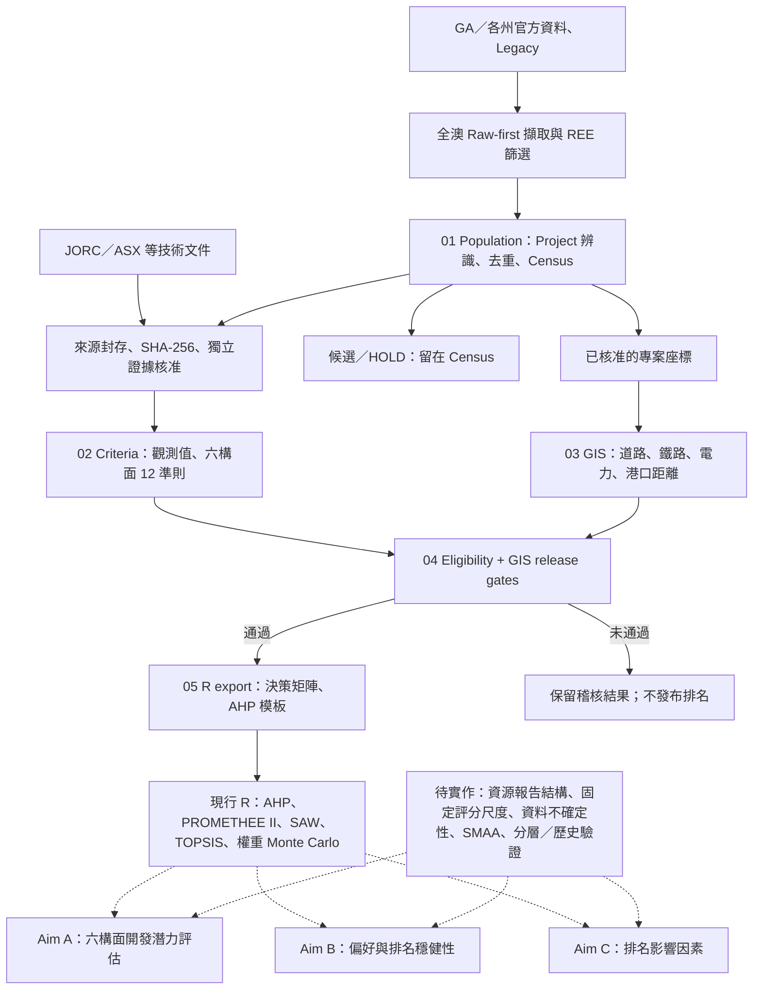

# Australian REE — Project Database & MCDA

## P2–P4 Batch 06 — 339 筆阻礙原因分類與跨層技術補查（2026-10-31）

[原因分類與實證核查報告](docs/audits/2026-10-31_p234_b06_reasons_and_followups_report.md) · [339 筆逐列原因 CSV](docs/audits/2026-10-31_p234_b06_reason_classification_339.csv) · [原因摘要 JSON](docs/audits/2026-10-31_p234_b06_reason_summary.json) · [4 筆 P2 官方原文](inputs/source_review_20261031/p234_b06_p2_public_primary_reviews.csv) · [8 筆相關但未核准相同來源的索引](inputs/source_review_20261031/p234_b06_related_locator_cases.csv)。PR #45／#46／#47 已先依序合併。新增 P2 Arthur Popes、Blues Folley、Bells Monazite、Elaine Dorothy 來源判讀：P2 公開文字有界複核 **20／28**、仍待技術原件 **8**；P3／P4 原生圖徵 87＋64 筆待補，維持 **100** 個共同取件單位；全部 **159 筆／108 工作單位**為技術原件優先佇列。原始證據八類原因與現況七類工作阻礙分開，特別修正 Elaine Dorothy P2 與 P3 對 2010 **83,000t @ 3,200ppm TREO** 歷史 JORC 記載的不一致，並隔離 Wolfram Hill Bell's Monazite／Cox Peninsula Bells Mona 同名誤認。P4 Spartacus、North Bleechmore Dykes、Skyfall 新定位證據尚待 exact native ID 相符，**不虛增完成原件數**。119 筆 C0 來源結案候選與 ADR-P0-028 凍結規則仍未核准；C1/JORC/GIS/MCDA 不更動。驗證：`python scripts/build_p234_reason_classification_b06.py --check`。


## P2–P4 B05 — 339 筆全量分流、100 組原生 ID 與凍結規則草案（2026-10-31）

[報告與凍結規則討論](docs/audits/2026-10-31_p234_b05_triage_and_freeze_proposal.md) · [339 筆逐列分流 CSV](docs/audits/2026-10-31_p234_b05_source_triage_339.csv) · [P3/P4 100 組 native ID crosswalk](docs/audits/2026-10-31_p34_b05_native_workgroups_100.csv) · [112 組待辦](docs/audits/2026-10-31_p234_b05_priority_work_queue_112.csv) · [B05 摘要 JSON](docs/audits/2026-10-31_p234_b05_triage_summary.json)。新增 **4 筆 P2 具名官方／發行人資料範圍判讀**（Duke、Bruce Prospect、Plenty River、Brumby Clydesdale），P2 待原文補強 **12** 筆；P3/P4 仍有 **87／64** 筆 native-only，這 151 筆依同州政府原生 ID 組織為 **100** 個取件單位、51 組共享 ID，保持全部來源 ID。另獲 NT Skyfall 原始報告索引兩筆 locator，未宣稱來源點 crosswalk 已完成。143 筆有保存原件相關內容、32 筆有公開文字判讀、1 筆網頁快取、12 筆舊 P2 桌面審查、151 筆僅 native。篩選 **119 筆來源層結案審查候選**，**尚未凍結或簽核**；保留 C1/JORC/GIS/13 案/MCDA 0 核准。可重跑 `python scripts/build_p234_source_triage_b05.py --check`。本 PR 疊加尚未合併之 B03/B04，合併順序應依 PR #45 → #46 → 本批處理。


## P2–P4 339 筆全量持續核查 Batch 04（2026-10-31）

[Batch 04 報告](docs/audits/2026-10-31_p234_all_339_continuation_b04_report.md) · [339 筆逐列可編輯進度](docs/audits/2026-10-31_p234_all_339_continuation_b04.csv) · [新增 9 筆 P2 官方原文判讀](inputs/source_review_20261031/p2_external_primary_batch04_20261031.csv) · [8 筆 P3/P4 來源定位嘗試](inputs/source_review_20261031/p34_batch04_locator_attempts.csv)。保留凍結 2026-10-29 基線與 Batch01–03，P2 新增 9 筆直接官方／發行人來源範圍判讀（累計 12/28，16 筆待技術原件）；P3/P4 新增 8 筆定位核查紀錄但**沒有新技術原件核定**，仍各有 87／64 筆僅原生圖徵待補。三類合計 **167 筆仍待技術原文補強**；全部 339 筆持續保有可追蹤分類。原始 PDF bytes/全文與獨立 C1／JORC／GIS／MCDA 核准均未新增。本批依序疊在未合併 Batch 03 之上，獨立 PR 不直接更改 `main`。


## 外部技術原件補查 Batch 03 — Ketchowla／Oak Dam East（2026-10-31）

[第三批 6 筆來源核對報告](docs/audits/2026-10-31_external_primary_batch03_review.md) · [6 筆可編輯來源判讀](inputs/source_review_20261031/external_primary_batch03_20261031.csv) · [新版 167 筆進度](docs/audits/2026-10-31_external_primary_progress_167_b03.csv)。累計 **16／167** 筆有界外部技術文字查核，**151** 筆待補；本批 Ketchowla K3（2）、Ketchowla Hill（2）與 Oak Dam East（2）確認歷史 Mn/Fe/Cu 資源和 K9 REE 探勘結果不得轉寫為其他礦點的 REO JORC/TREO。外部 PDF 搜尋文字可讀但頁面影像與原始位元組未成功封存，相關 C1、JORC、GIS、13 案 Gate、MCDA 仍 HOLD。保留 Batch-02 原版 167 筆進度，另建新版；維持固定 412 IDs 和 2026-10-29 快照。


## 外部技術原件 Batch 02 — 來源範圍與持續查核（2026-10-31）

[第二批具體來源核對報告](docs/audits/2026-10-31_external_primary_batch02_review.md) · [第二批 5 筆可編輯判讀表](inputs/source_review_20261031/external_primary_batch02_20261031.csv) · [完整 167 筆逐列進度](docs/audits/2026-10-31_external_primary_progress_167.csv)。兩批共有 **10／167** 筆取得有界的發行人／官方／原始研究文本判讀，另外 **157** 筆仍需技術原件；本環境未取得這些 PDF 位元組，不能當成已完成原件驗證。新增 Pindari（2）、Acropolis（2）、Murray Basin（1）的 Project/Deposit、REE 品位與原件範圍判讀。P2 仍為 3 筆新複核／25 筆待全文，Scaddan 原始 PDF 缺口繼續 HOLD。412 ID、2026-10-29 快照與全部正式 Gate 不變。

## 外部技術原件補查 Batch 01（2026-10-31）

[首批實質證據與結案邊界](docs/audits/2026-10-31_external_primary_batch01_review.md) · [9 筆來源原文判讀 CSV](inputs/source_review_20261031/external_primary_batch01_20261031.csv) · [28 筆 P2 交叉複核及待查清單](docs/audits/2026-10-31_p2_28_recheck_tracker.csv)。167 筆 native-only 中 5 筆補 issuer PDF 公開原文的技術判讀，P2 28 筆完成基線／ID 核對且 3 筆直接重讀州政府原文，Scaddan 增加 2025 年新版供應商資料與 2024 年「ionic clay」描述衝突。公開網頁可讀文本**不等於取得原始 PDF 位元組及 SHA**，162 筆 native 與 25 筆 P2 原件仍待查，Scaddan byte gap 未解。所有固定 ID、2026-10-29 快照、C1／13案 Gate／MCDA 皆不變。

可重現的**澳洲稀土礦業專案資料庫**及多準則決策分析（MCDA）研究。以官方礦產資料、技術報告與 GIS 為證據，評估開發潛力、排名穩健性及影響因素。使用 Python 3.11+、SQLite、R，並以 Git/快照維持可追溯性。

## P2／P3／P4 證據狀態收斂（2026-10-31）

[最新報告](docs/audits/2026-10-31_p234_final_evidence_report.md)：P2 28／27 案、P3 216、P4 95，合計 **339 筆全部已有明確證據狀態**。本次 9 筆中，5 筆取得原引用原件，Quantum 兩筆及 Mindarie 一筆取得直接相關替代官方原件；Scaddan 原檔因出版者網域與公開封存不可取得而保留存取 HOLD。舊引用的實體取件仍有 4 筆殘餘，沒有把替代原件冒稱為原 URL 已下載。

[339 筆 CSV](docs/audits/2026-10-31_p234_final_evidence_339.csv)／[JSON](docs/audits/2026-10-31_p234_final_evidence_339.json)含當前狀態、實質判讀、範圍限制及重開條件。143 筆為保存原件的相關內容查核、1 筆快取文字、28 筆沿用 P2 桌面審查、167 筆原生圖徵查核，**不宣稱全部技術全文或准入已完成**。固定 412 ID、2026-10-29 快照、核准不變；C1、13 案 Gate 與 MCDA 暫緩。無新原件／入口／範圍證據時停止同一失敗 URL 的重複查找，按逐筆條件重開。

## 前批紀錄：144 HOLD 原始文件與範圍查核（PR #41）

[本批報告](docs/audits/2026-10-31_p234_144_primary_scope_report.md)：固定 P3 118／P4 26 筆中，142 筆已讀本機原件相關頁，Scaddan 1 筆為網頁 PDF 閱讀，Yellowband Plain 1 筆仍未讀到原件。另 7 筆雖有替代原始內容，原指標文件仍未取得；共 9 筆保留取件缺口。全部保留逐筆範圍／礦權缺口，沒有新增 Project／C1／JORC 核准，13 案 Gate 與 MCDA 暫緩。

[144 筆 CSV](docs/audits/2026-10-31_p234_144_primary_scope_review.csv)／[JSON](docs/audits/2026-10-31_p234_144_primary_scope_review.json)、[339 筆更新對照](docs/audits/2026-10-31_p234_144_primary_scope_updated_339.csv)及[取件缺口](docs/audits/2026-10-31_p234_144_primary_scope_remaining_access.csv)可編輯。固定 412 ID 與 2026-10-29 快照保持不變。完整第三方原件留在本機，公開 CI 重跑雜湊／頁碼綁定及判讀帳本；不能將公開紀錄重跑等同於重新驗證未公開全文。

## 研究目標

| Aim | 研究問題 |
| --- | --- |
| **A — Development Potential** | 各專案的資源、稀土組成、技術、開發、基礎設施與商業條件如何？ |
| **B — Ranking Robustness** | 決策偏好、數據不確定性及 MCDA 方法會如何影響優先順序？ |
| **C — Ranking Drivers** | 哪些準則、礦床類型及開發階段與排名差異有關？ |

**後續研究一律以 [Research Architecture v2.0](docs/RESEARCH_ARCHITECTURE.md) 為總規格**，配合 [Data Specification](docs/DATA_SPECIFICATION.md)、[MCDA Protocol](docs/MCDA_PROTOCOL.md)、[Validation Protocol](docs/VALIDATION_PROTOCOL.md) 定義 Cohort、資料與統計設計；實作次序、驗收與 PR 規範見 [Research Implementation Plan](docs/RESEARCH_IMPLEMENTATION_PLAN.md)。既有程式為 v1 baseline，**v2 架構已寫入規格、尚未實作或發布正式六構面排名**。

## 研究架構（現行管線與研究目標）



實線表示已建立的資料／程式處理關係；虛線表示**研究目標及待補強的方法**，不代表已完成研究級成果。六構面為 Resource、Strategic Composition、Technical、Development、Infrastructure、Commercial/ESG；正式比較仍受獨立證據核准與 release gate 限制。
## 進度（截至 2026-10-30）

- **現有管線**：五階段 `population → criteria → gis → eligibility → r_export`；R 支援 AHP、PROMETHEE II、SAW、TOPSIS 與**權重** Monte Carlo。
- **全澳來源快照**：123,323 筆政府來源紀錄、1,006 筆 REE 篩選候選。兩者均**不代表獨立、已核准的 REE Project 數量**。
- **487 筆追溯審閱**：最新記錄為 69 筆候選、6 筆 REE 角色待查、412 筆身分／REE 證據不足，仍未形成正式 MCDA 項目清單。
- **待實作**：Project–Deposit–Resource 關聯、SMAA 資料不確定性、六構面共同評分、Aim C 影響因素與歷史回測。**未發布研究級正式排名**。

詳見 [Census release](CENSUS_RELEASE.md) 與 [資料／研究文件索引](docs/README.md)。

## 專案評估（依目前儲存庫與發布快照）

| 面向 | 判斷 | 下一個關鍵工作 |
| --- | --- | --- |
| **方法學** | A/B/C 研究問題、六構面和 MCDA 演算法已有完整架構；正式比較尚缺共同的六構面母體、固定尺度與資料不確定性 | 凍結準則／權重、檢查指標依賴與 Lifecycle Stage 重複計分 |
| **資料整理** | 官方 Raw-first、來源雜湊、證據審查及 Census 快照可追溯；Project 身分及企業／礦權關聯仍待大量核准 | 完成 Project–Deposit–Resource 關聯、來源核准與可比 JORC 數據 |
| **進度** | 資料擷取、重現性管線及合成 MCDA 測試已有成果；正式 Alternatives、研究級評分及 A/B/C 實證結果尚未發布 | 先建立可核准的 RS 六構面比較母體，再推進 SMAA 與 Drivers 分析 |

上述為**研究完成度的質性判斷**，不等於以未核准資料估算的量化進度。詳細依據與修正優先序見 [方法學、資料與進度評估](docs/PROJECT_ASSESSMENT_2026-10-30.md)。
## 後續研究／腳本修改原則

1. **先完成設計 Gate，再改程式**：C1 母體及六構面固定準則 → Project–Deposit–Resource/Evidence schema → utility/AHP → SMAA/Drivers → Historical。
2. 每次 PR 標示對應的 **Aim、P0–P3 Gate、資料/方法版本、測試與變更決策**；使用 [PR Template](.github/pull_request_template.md)。 開發進度統一記錄於 [Research v2.0 P0–P3 工作追蹤](https://github.com/lleeoo0611-stack/AU_REE/issues/14)。
3. 研究參數尚未定稿時，先更新 [Research Decisions](docs/RESEARCH_DECISIONS.md) 與 Protocol，再以獨立 PR 實作；不得改寫舊有研究快照或將候選 Project 直接納入正式 MCDA。

### P0 — 下一階段研究設計（2026-10-31）

已建立 [C1 納入審查規則](docs/P0_COHORT_SELECTION_PROTOCOL.md)、[Project–Deposit–JORC Schema](docs/P0_PROJECT_RESOURCE_SCHEMA.md) 和 [39 群組資料盤點](docs/audits/P0_C1_READINESS_2026-10-31.md)；[逐群組可編輯審查 CSV](docs/audits/2026-10-31_c1_review_groups.csv) 與 JORC/Project Review 表單供後續填寫。**本階段僅完成方法／資料盤點，C1 尚未核准、v2 資料庫 migration 尚未實作。**

### P0.1 — 39 個 Project 群組來源篩查（2026-10-31）

[逐案核查結果與分布](docs/audits/2026-10-31_project_source_screen_report.md) · [39 個 Project 審查 CSV](docs/audits/2026-10-31_project_source_screen_39.csv) · [來源與分類 Manifest](docs/audits/2026-10-31_project_source_screen_39.manifest.json)。39 組按州別為 VIC 11、SA 7、QLD 7、NSW 6、NT 3、WA 3、TAS 2；7 組具已公開研究階段證據、8 組需確認 Study／FID、14 組資源/勘探層級、7 組 REE role HOLD、2 組已超出 pre-FID、1 組暫停。**以上屬來源篩查，正式 C1 尚未核准。**

### P0.1 — 487 筆來源全量批次整合（2026-10-31）

已將原 **487 筆 source targets** 一次整合為可重跑的 [逐筆審查 CSV](docs/audits/2026-10-31_census_487_batch_review.csv)（來源 ID、entity type、Project linkage、證據定位、Tenement/Company 核查、優先工作、C1 Gate）；[完整分布與方法報告](docs/audits/2026-10-31_census_487_batch_review_report.md) · [機器可讀 QA 統計](docs/audits/2026-10-31_census_487_batch_review_summary.json)。487 筆包括 323 Deposit、102 Occurrence、50 Project source records、6 Historical、6 Prospect；**78 筆連結 39 個審閱群組，409 筆未連結**。這是完整的 **source-level inventory audit**，不等於 487 個獨立 Project 已驗證；**正式 C1 及 MCDA 排名尚未核准**。批次更新程式：[scripts/build_p0_census_487_audit.py](scripts/build_p0_census_487_audit.py)。

### P0.1 — 487 筆證據主張審查（2026-10-31）

[完整證據審查報告](docs/audits/2026-10-31_487_evidence_review_report.md) · [487 筆證據核對 CSV](docs/audits/2026-10-31_487_evidence_claim_review.csv) · [來源品質統計](docs/audits/2026-10-31_487_evidence_claim_summary.json)。整合原始 441 筆來源追溯、95 筆既有文件定位及西澳政府 20 個 REE 資源清單項目；另記錄 NT Plenty River → Bruce Project 的 Prospect/Project 文字證據。**所有來源仍需獨立核准才能進入 C1，未改動原有正式排名。** 可重跑：[scripts/review_p0_487_evidence.py](scripts/review_p0_487_evidence.py)。

### P0.1 — 487 筆證據複核（第二輪，2026-10-31）

在保留全部 487 個來源 ID 與原始審查結論下，[第二輪證據報告](docs/audits/2026-10-31_evidence_round2_report.md)與[完整可編輯 CSV](docs/audits/2026-10-31_487_evidence_round2_review.csv)補入 **86 筆外部來源線索**：僅有原生資料 336→272、缺原生資料且無文件定位 23→3；原生 ID 歧義 2 筆已有官方背景，**仍須辨識原始 4／6 筆 feature rows**。提供[86 筆異動紀錄](docs/audits/2026-10-31_evidence_round2_changed_targets.csv)、[可重跑腳本](scripts/review_p0_evidence_round2.py)與[來源定位表](inputs/source_review_20261031/round2_external_evidence_leads.csv)。仍未發布正式 C1。

### P0 — 原始政府資料復原（2026-10-31）

[政府原始資料審查報告](docs/audits/2026-10-31_original_archive_recovery_report.md) · [272 筆原生來源](docs/audits/2026-10-31_272_native_project_scope_triage.csv) · [23 筆原始來源恢復](docs/audits/2026-10-31_23_native_source_recovery.csv) · [南澳 10 筆 feature 身分核對](docs/audits/2026-10-31_sa_10_duplicate_source_features.csv) · [6 筆 Project parent 候選](docs/audits/2026-10-31_272_project_parent_candidates_6.csv)。從 GitHub Actions 的 2026-10-29 原始政府封存核對 272/272 native source records；GA 7 筆恢復 JSON bytes、Legacy 16 筆恢復原始歷史列（原始 `project_id` 與現行 Legacy UUID 一致）。Olympic Dam／Clarke 的 4／6 筆來源列已區分，不重複計為礦床／Project。**所有 C1/JORC/GIS 核准維持不變。**

### P0 — 原生恢復與 Project 父子歸屬（2026-10-31，第三輪）

[第三輪完整研究報告](docs/audits/2026-10-31_p0_native_parent_resolution_report.md) · [272 筆 Project parent 證據表](docs/audits/2026-10-31_272_project_parent_evidence_queue.csv) · [23 筆已實際恢復來源紀錄](docs/audits/2026-10-31_23_original_native_bytes_verified.csv) · [SA 10 筆唯一複合識別碼](docs/audits/2026-10-31_sa_10_compound_feature_keys.csv) · [原始 GA/SA 位元組](data/raw_snapshots/2026-10-29/)。

以 2026-10-29 全澳政府原始快照實際回查，**272/272 唯一 source-native feature、23/23 原生來源位元組驗證、兩個 SA 礦床 ID 的 10 筆 OBJECTID 唯一化**。在 272 個來源列中找到 **15 筆具 REE Project/勘探歸屬候選、4 筆已知非 REE Project**；其餘分為 92 個非 Project 地質圖徵、2 個上層 Deposit、3 個主題類別、156 個缺 Project 母層。以上不是獨立 Project 個數，**C1 仍待核准**。

### P0 第四輪：156 筆 Project 母層證據審查（2026-10-31）

[完整審查報告](docs/audits/2026-10-31_156_project_parent_review_report.md) · [156 筆逐列 CSV](docs/audits/2026-10-31_156_project_parent_evidence_review.csv) · [148 筆待補 Project 關係](docs/audits/2026-10-31_156_project_parent_gaps.csv) · [摘要與來源 SHA](docs/audits/2026-10-31_156_project_parent_evidence_summary.json)。保留政府原始 source feature 與來源稽核，新增 **8 筆具名 Project 文件候選、3 筆名稱／範圍待查**；145 筆仍無新增 Project 文獻，70 筆有跨來源同州同名線索。**來源具名 ≠ 獨立 REE Project 核准；全部 C1 維持 NO。**

### P0 第五輪：109 筆 Project 母層證據審查（2026-10-31）

[109 筆逐列原始來源與外部文件審核](docs/audits/2026-10-31_109_project_evidence_review.csv) · [完整研究報告](docs/audits/2026-10-31_109_project_parent_review_report.md) · [來源 SHA 與計數](docs/audits/2026-10-31_109_project_evidence_summary.json)。**39 筆有新增獨立文件線索**：20 筆歷史 Project parent 候選、10 筆地理／礦權／名稱範圍 HOLD、9 筆僅增加地質／HMS 文件；70 筆仍只有政府原生地質紀錄。全體保留 C0，**0 筆 Project/JORC/C1 自動核准**。對同州同名 44 筆另作座標交叉稽核，其中 Ambergate 2 個來源相距 38.738 km，已暫停同名配對。可重跑：[scripts/audit_p0_109_project_parents.py](scripts/audit_p0_109_project_parents.py)。

### P0 第六輪：70 筆原生礦產紀錄再審核（2026-10-31）

[70 筆逐列可編輯證據表](docs/audits/2026-10-31_70_project_evidence_review.csv) · [完整科學判讀報告](docs/audits/2026-10-31_70_project_parent_review_report.md) · [來源 SHA、結果與分布](docs/audits/2026-10-31_70_project_evidence_summary.json)。以 frozen GA/州政府 native source 回查，**34 筆新增外部文獻線索**：7 筆官方／公司歷史 Project parent 候選、4 筆歷史 WAMEX 報告索引候選、8 筆礦權／行政區／地理 scope HOLD、15 筆地質／非主要稀土證據；**36 筆**仍無新外部文獻。所有 **70 筆獨立 Project/JORC/C1 均未核准**。可重跑：[70-row 原始來源審查 Python](scripts/audit_p0_70_project_parents.py)。

### P0 P1 — 73 筆母體 Project 身分優先查核（2026-10-31）

從 412 筆 HOLD 以 frozen source target IDs 選出 **73 筆 P1**：48 筆具名或歷史 Project 父層候選、4 筆 WAMEX 報告索引、21 筆身分／tenement／州界範圍 HOLD。Ambergate 2 筆同名來源相距 38.738 km，已列身分 HOLD，禁止直接合併。本輪另新增 25 筆來源列的定向政府／發行人／獨立技術報告及 WAMEX 索引／原生空間 QA 查核，全部保留 C0，**Project/JORC/C1 正式核准維持 0**。

[完整報告](docs/audits/2026-10-31_p1_parent_identity_report.md) · [73 筆可編輯 CSV](docs/audits/2026-10-31_p1_parent_identity_review.csv) · [25 筆逐列核查登錄](inputs/source_review_20261031/p1_parent_identity_web_checks.csv) · [統計 JSON](docs/audits/2026-10-31_p1_parent_identity_summary.json) · [可重跑腳本](scripts/audit_p0_p1_parent_identity.py)。

### P0 P1 — 48 筆具名母層去重與 REE 資源範圍（2026-10-31）

在 [73 筆 P1 查核](docs/audits/2026-10-31_p1_parent_identity_report.md) 中固定 **48 筆 Project 母層候選**，產生 **39 個來源名稱鍵、25 個暫定 Project 母層群組**，保留原始 target/source ID 與 SHA；跨專案、跨礦床的資源不重複計數；Aileron 2026 年 Nb₂O₅ 資源更新與 2025 年 TREO 品位分別保存，禁止自動跨年混用。**5 組**有 TREO 數值主張、**2 組**有 REE 產品證據但 HM 與 REO 基準須拆分、**1 組**只有 REE 探勘交集，另 **17 組**維持 REE 資源待查。已完成來源座標分散度 QA，既有官方 Tenement polygon 點位交集已可查，正式 Project 開發範圍與 C1 核准仍待執行。

[逐群組報告](docs/audits/2026-10-31_p1_48_dedupe_report.md) · [48 筆 source crosswalk](docs/audits/2026-10-31_p1_48_source_parent_crosswalk.csv) · [25 組去重總表](docs/audits/2026-10-31_p1_25_provisional_parent_groups.csv) · [14 筆資源基準](docs/audits/2026-10-31_p1_48_resource_basis_review.csv) · [審核腳本](scripts/audit_p0_p1_48_dedupe.py) · [統計 JSON](docs/audits/2026-10-31_p1_48_dedupe_summary.json)。

### P0 P1 — 73 筆完整文件判讀與官方礦權對照（2026-10-31）

將 73 個原始來源 ID 整理為 **44 個證據案例**（25 個父層候選、19 個身分或 WAMEX 案例），全部有文件主張／查無支持的範圍與下一步。結果：22 筆來源有特定 Project 或資源文字證據、40 筆僅支持非 REE 產品／地質／歷史背景、2 筆明確不可繼承 REE MRE、4 筆身分衝突、5 筆 WAMEX 待官方原件；Wemen 政府統計原文已補強。重用官方 487 Tenement spatial snapshot 發現 **60/73** 筆有礦權圖層交集，**20 筆**與文件礦權號碼一致；**Project 開發 footprint 與正式 C1 仍待獨立核准**。

[完整 44 案例報告](docs/audits/2026-10-31_p1_73_resolution_report.md) · [73 筆來源判讀 CSV](docs/audits/2026-10-31_p1_73_source_resolution.csv) · [44 案例決策 CSV](docs/audits/2026-10-31_p1_44_case_resolution.csv) · [73 筆官方礦權對照](docs/audits/2026-10-31_p1_73_tenure_reconciliation.csv) · [再生腳本](scripts/audit_p0_p1_73_resolution.py)／[礦權比對腳本](scripts/audit_p0_p1_73_tenure.py)。

### P0／P1 桌面審核結案與發布 Gate（2026-10-31）

固定 73 筆原始 P1 來源完成 **44 案例**文獻查核與最終來源級處置：**22** 筆保留 Project／REE 正向線索並逐案六層 Gate HOLD、**40** 筆已查來源不支持同範圍 REE 產品、**2** 筆禁止錯誤資源繼承、**4** 筆位置／州界身分衝突、**5** 筆已定位 4 份 WAMEX 報告但原始檔封存受阻。Wemen 已以維多利亞政府 2003/04 統計確認是 2004 年停止生產的歷史礦場；不再標記成只有目錄。

既有政府來源級 **204** 筆 tenement 交集對應 **60/73** source points；文件號碼精確對上 **20** 筆來源（12 個案例）。這不等於 Project 開發區界。**P1 73 筆文件搜尋與來源判讀已結案；Repository 公開後 GitHub Actions 已正常執行，P0/P1 快照、Python 離線回歸與 R MCDA 合成資料測試皆通過。PR #26、#27、#28 已依序合併 `main`，PR #31 彙整正式結案記錄。Project／JORC／GIS／C1 獨立簽核維持 0，未發布研究級排名。**

[結案報告](docs/audits/2026-10-31_p0_p1_closeout_report.md) · [73 筆結案 CSV](docs/audits/2026-10-31_p0_p1_73_terminal_decisions.csv) · [13 案 C1 Gate 審核](inputs/source_review_20261031/p1_13_positive_case_gate_decisions.csv) · [重跑腳本](scripts/audit_p0_p1_closeout.py) · [CI 實測通過紀錄](docs/audits/2026-10-31_p0_p1_ci_verification.json) · [CI 問題追蹤 #29](https://github.com/lleeoo0611-stack/AU_REE/issues/29) · [WAMEX #30](https://github.com/lleeoo0611-stack/AU_REE/issues/30) · [C1 13 案正式 Gate #32](https://github.com/lleeoo0611-stack/AU_REE/issues/32)。

### P2 — 原 412 筆 HOLD 中 28 筆來源初審（2026-10-31）

以原本固定優先順序重建 **P1 73 + P2 28 + P3 216 + P4 95 = 412**。P2 包含 **22 筆 Legacy + 6 筆 E1 原始紀錄**，整理為 **27 個暫定來源站址案例**；不等於 27 個獨立 Project。已建立資料可再生腳本和 28 筆逐列 CSV、27 案例證據表，並確認政府／發行人文件脈絡：Mary Kathleen 舊礦場與尾礦研發分離、Port Pirie REE 為歷史處理場、Anchor Tin Deeps 2024 年 REE 鑽探、NT Boulder Ridge、Bruce/Plenty River、Elaine Dorothy、Iluka Douglas 等。**P2 仍在證據第一輪（Phase 1），原 412 Census、P1 結案、C1 身分／JORC／GIS／Panel Gate 皆維持不變。**

[完整 P2 Phase 1 報告](docs/audits/2026-10-31_p2_phase1_report.md) · [28 筆來源 CSV](docs/audits/2026-10-31_p2_28_source_triage.csv) · [27 案例 CSV](docs/audits/2026-10-31_p2_27_case_triage.csv) · [27 案證據輸入](inputs/source_review_20261031/p2_27_case_evidence.csv) · [P2 QA JSON](docs/audits/2026-10-31_p2_phase1_summary.json) · [P2 CI 實測](docs/audits/2026-10-31_p2_phase1_ci_verification.json) · [可重跑腳本](scripts/audit_p2_28_initial_triage.py) · [後續 Project/Title 核對 #35](https://github.com/lleeoo0611-stack/AU_REE/issues/35)。

### P1／P2 公開證據收尾（2026-10-31）

在固定 **412 HOLD = P1 73 + P2 28 + P3 216 + P4 95** 母數下，針對 **P1 剩餘 19 案／31 個來源**完成公開可取得資料的限定複核；13 個正向案例、2 個 Ambergate/Wingellina 身分衝突與 4 份 WAMEX 索引（5 source rows）均有逐案最新證據、頁面／日期與再開案條件。**四份 WAMEX 官方 PDF 位元組與 SHA 仍無法公開直接取得**，本輪不寄信、無正式 C1 簽核。

P2 **28/28 source rows、27 個暫定案例完成公開文件審核處置**：17 案具政府／發行人原始線索而待來源–Project 身分核准、1 案研究階段不包含 REE、3 案歷史礦場／尾礦處理場、1 案指定鑽探的 REE 負結果、3 案僅政府原生 feature、2 案區域索引／名稱歧義。新增可追溯證據包含 NT Bell's Monazite、Arthur Popes、Blueys Folley、Duke，及 TAS Blue Tier／Cruncher／DC／Tunnel Hill、VIC Wedderburn／QLD Brumby 等。**C1、JORC、GIS_RELEASE 及六構面正式 Panel 依原 Gate 保持未核准。**

[完整研究報告](docs/audits/2026-10-31_p1_p2_public_evidence_closeout_report.md) · [P1 31 筆來源 CSV](docs/audits/2026-10-31_p1_31_remaining_public_source_review.csv) · [P2 28 筆來源 CSV](docs/audits/2026-10-31_p2_28_public_terminal_desk_review.csv) · [機器 QA 摘要](docs/audits/2026-10-31_p1_p2_public_review_summary.json) · [可再生程式](scripts/audit_p1_p2_public_evidence.py)。


### P0 — 412 HOLD 的 P3／P4 provenance、13 案 C1 與 P2 身分覆核（2026-10-31）

[完整報告](docs/audits/2026-10-31_412_followup_gates_report.md) · [P3/P4 311 筆可編輯證據表](docs/audits/2026-10-31_p3_p4_311_provenance_audit.csv) · [13 案 C1 Gate](docs/audits/2026-10-31_c1_13_independent_gate_readiness.csv) · [P2 28 筆原始身分對照](docs/audits/2026-10-31_p2_28_identity_crosswalk.csv) · [QA 統計](docs/audits/2026-10-31_412_followup_gates_summary.json)。

412 個原 HOLD ID 無遺漏、無重覆：P1 73／P2 28／P3 216／P4 95。P3/P4 本輪完成來源級 provenance triage，並核對 194 筆已封存政府 native source 的 ID/source key/hash（0 衝突；不是逐份新 PDF 全文核准）；13 案／22 來源完成跨表 Gate readiness 對照，**正式獨立 C1 Project／JORC／GIS 核准仍為 0**。P2 27 案完成源 ID／Legacy crosswalk 缺口補強。PR #33 已合併；其舊 action_priority P2 72 筆定義不同，已用 source ID 對應現行 412 HOLD：28 筆為 HOLD P2、38 筆原 INCLUDE_CANDIDATE、6 筆原 HOLD_REE_ROLE，不額外增加 412 母數。可重跑 \`python scripts/audit_p0_412_gate_continuation.py --check\`。

### Legacy 487 優先級 P2 的 72 筆整併（2026-10-31）

[72-row intake](docs/audits/2026-10-31_p2_72_intake_report.md) · [72 筆 priority 映射 CSV](docs/audits/2026-10-31_legacy_p2_72_to_412_crosswalk.csv) · [47 案例表](docs/audits/2026-10-31_p2_case_review_queue.csv)。此處 `action_priority=P2` 的 72 筆，與原 412 HOLD 的 P2 28 筆 **重疊 28**；另外 38 筆原 INCLUDE_CANDIDATE、6 筆原 HOLD_REE_ROLE 不在 412 HOLD 中。增列 7 筆具日期文件線索，對應 22 筆來源，僅作 source-scoped documentation；正式 Project/JORC/C1 仍為 0。對應 [PR #33](https://github.com/lleeoo0611-stack/AU_REE/pull/33)。

### P2／P3／P4 固定來源 documentary disposition（2026-10-31）

在 `main@aeddd2e` 基線上，完成 **339 個原始來源 ID** 的來源內容檢視與逐筆處置：P2 28／27 暫定案例、P3 216、P4 95。從 2026-10-29 完整政府封存驗證 chunk SHA 並選取 **317 個政府來源**，另核對 **22 個純 Legacy 原列**；全部 52 個 Legacy target IDs 均保留歷史 UUID，其中 30 筆同時連結政府圖徵。更正舊表 7 筆 GA「未恢復」與 SA 2 個原生 ID 的 4／6 feature 歧義，歷史表保留原樣。

**P3／P4：167 筆限定 C0 原生內容審查完成；144 筆文件指標仍 HOLD，待原件／範圍審查。** P2 沿用前輪限定桌面判讀，未宣稱本輪重新全文驗證。來源處置結案不等於 Project 證據充分；**新增技術文件全文驗證 0、正式核准 0；C1、13 案 Gate 與 MCDA 依使用者指示暫緩**。

[範圍與結案報告](docs/audits/2026-10-31_p2_p3_p4_closeout_report.md) · [339 筆可編輯 CSV](docs/audits/2026-10-31_p2_p3_p4_closeout.csv) · [完整 JSON／歷次證據](docs/audits/2026-10-31_p2_p3_p4_closeout.json) · [144 筆原件待核清單](docs/audits/2026-10-31_p2_p3_p4_closeout_document_pointer_holds.csv) · [QA／輸入 SHA](docs/audits/2026-10-31_p2_p3_p4_closeout_summary.json)。執行 ID `P234-DOC-CLOSEOUT-20261031-V1`；重跑 `python scripts/closeout_p2_p3_p4.py --check`。離線重跑只驗證衍生選集與結果；重新核對原始 bytes 須提供原封存並執行 `--extract-raw --raw-root`。

## 專案結構

```text
AU_REE/
├── src/au_ree/           # 五階段 Python pipeline 與 CLI
├── R/                    # AHP、PROMETHEE、SAW、TOPSIS
├── config/               # 準則、納入規則、GIS、權重假設
├── db/migrations/        # SQL schema migrations
├── scripts/              # 全澳政府來源、候選篩選與專項分析
├── reproducibility/      # 487 筆工作包、快照、QA、重建
│   └── workpack/         # 歷史審閱工作包專用腳本
├── inputs/               # 凍結/可編輯研究輸入及審查紀錄
├── outputs/              # 已追蹤的審閱成果、CSV 與 manifests
├── artifacts/            # 可攜發布包
├── tests/                 # Python 與合成資料驗收測試
├── docs/                  # 方法、規格、進度、歷史報告
└── .github/workflows/     # CI 與政府來源更新
```

歷史審閱的原始 ID、來源檔與輸出路徑保留；`work/` 為未追蹤的本機暫存資料。資料夾詳細用途與索引見 [docs/README.md](docs/README.md)。

## 快速開始

```bash
python -m pip install -e '.[test]'
au-ree plan
au-ree run --through r_export --offline
au-ree status
python -m pytest -q
```

正式輸入需有**來源原件 SHA-256 + 獨立證據核准**，不可因 CSV 寫入 `VERIFIED` 就視為研究級資料。沒有合格資料時，正式 MCDA 決策矩陣可能為空表，程式不得產生捏造排名。

- 官方資料更新、單階段重跑及 R 分析：[操作說明](docs/RUNBOOK.md)
- 487 筆審閱重建：[工作包說明](reproducibility/workpack/README.md) · [Release](CENSUS_RELEASE.md)
- 已追蹤資料輸出：[Outputs index](outputs/README.md)
- 版本與協作：[Git workflow](docs/GIT_WORKFLOW.md) · [Changelog](docs/CHANGELOG.md)

## 分析原則

1. **Census ≠ MCDA alternatives**：Project、Deposit、Prospect、Tenement 分層保存；正式評分需通過 eligibility、來源及 GIS gate。
2. **G0 ≠ 完整六構面**：現有 `G0_BASELINE` 只涵蓋 T/D/I/C；`R1_STRICT`、`S1_DIRECT`、`RS_STRICT` 為**資料/母體情境**，另有 resource/development/strategic-supply **權重情境**。
3. **缺資料不給零分**：未核准、來源衝突、數據基準不符的紀錄保留於審查，不進入正式數值矩陣。
4. **版本可重現**：原始來源、日期、雜湊、評分/權重設定與輸出 manifest 綁定快照；新的研究資料不覆蓋舊版。
