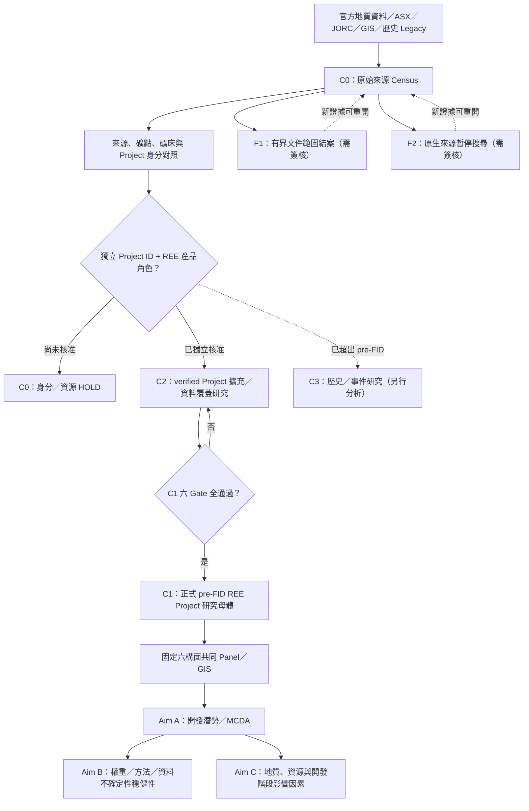
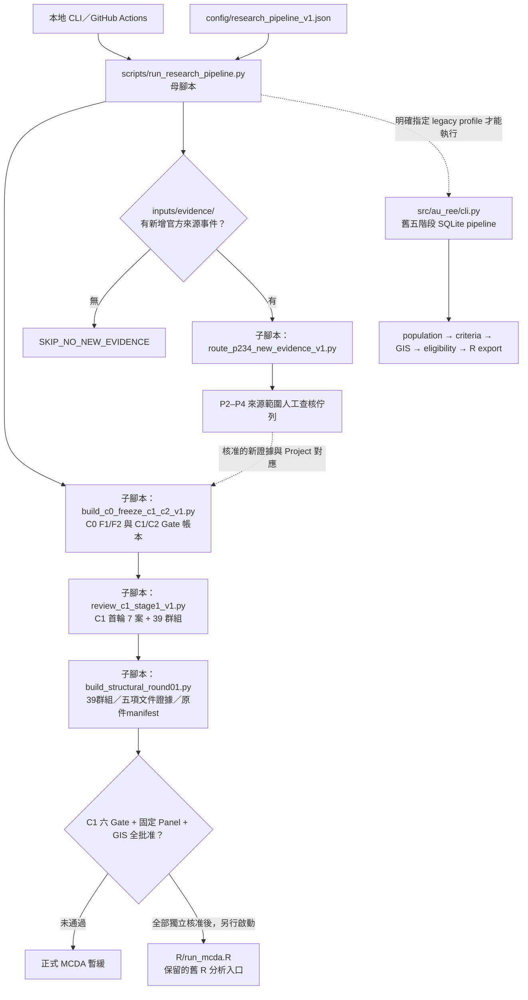

# Australian Rare Earths — Evidence Database & GIS/MCDA Research

以官方來源、技術研究、JORC 資源與 GIS 建立**可更新、可重現的澳洲稀土礦業 Project 資料庫**，用於開發潛勢比較（Aim A）、排名穩健性（Aim B）、重要因素辨識（Aim C）。使用 Python、SQLite、R 與 GitHub Actions。

**研究主線：C1 Project 身分與六 Gate 審查 → 固定六構面 Panel → 正式 MCDA／敏感度與影響因素分析。** P2–P4 來源查核為新證據觸發的支線。原始 Census source row、地質 occurrence、Deposit、Prospect、Tenement 與**獨立 Project** 必須明確區分。

## 目前研究狀態

| 層級 | 已建置／進度 | 正式核准 |
| --- | --- | --- |
| 原始 Census | 487 source targets 的原始證據、source ID 與可重現追溯；2026-10-29 frozen snapshot | Census ≠ C1 |
| C0 F1：文件支持的來源範圍結案 | 119 筆候選 | **0** 筆來源簽核 |
| C0 F2：政府原生圖徵暫停重複搜尋 | 151 筆候選，6 筆有待對應的新報告線索 | **0** 筆暫停簽核 |
| C1 / C2 母體 | 39 個 Project 審查群組；另有 13 個 P1 正向 source cases 待交叉對照 | **C1 = 0、C2 = 0** |
| C1 首輪原文查核（2026-11-01） | **7 個**經濟研究線索群組有新的有界政府／發行人來源文字；32 個保留先前初審 | 7/39 是證據補查，不是准入 |
| Execution Round 01（接續首輪） | **39 群組有界分類、9 群組技術原件頁面審查；13 PDF＋23 HTML 原件；24 個文件缺口解決** | 27/195 文件格可送審；Jupiter 五項文件包 ready 1；正式 Structural/C1/C2 仍 0 |
| P2–P4 備查 | P2 8 筆、P3 87 筆、P4 64 筆需外部技術原文補強；P3/P4 151 筆可整理為 100 組原生 ID 取件工作單位 | 只在新的來源事件出現時重新啟動 |
| MCDA | 舊版 Python 五階段與 R 運算程式保留；六構面 9/12 準則候選尚未固定 | **不得宣稱正式 C1 排名** |

原始來源快照截止日：**2026-10-29**；本版腳本與來源複核：**2026-11-01**。完整詳細資料見 [C0/C1/C2 政策](docs/C0_FREEZE_AND_C1_C2_POLICY.md)、[C1 首輪 7 案核查](docs/audits/2026-11-01_c1_stage1_source_review.md)、[339 筆 P2–P4 原因分類](docs/audits/2026-10-31_p234_b06_reasons_and_followups_report.md)。

**最新成果：[Structural Round 01 報告與完整表格索引](docs/audits/structural_round01/REPORT.md)。** 同範圍 REO 原始表有 7 組，其中 4 組 JORC 文件格可送審；8 組取得截止日前經濟研究發布原件，但研究完成不自動證明 cutoff 時仍 pre-FID。GIS_SOURCE 只定位原圖件，**不是 GIS_RELEASE 核准**；8 組 ID＋ROLE 文件候選均未獨立核准，C2 仍 0。Core／Extended Panel 未選定。

## 研究架構圖



**C1 的六項准入 Gate：** `ID → ROLE → WINDOW → JORC → PANEL → GIS_RELEASE`，須獨立證據及簽核。C2 只在 Project ID 與 REE 角色確實核准、其餘 C1 Gate 尚未全通過時建立，絕不直接混入正式 C1 排名。

## 腳本架構圖：母腳本控制子腳本



主線優先驗證 C1 Project，**沒有新證據事件就跳過 P2–P4 子腳本**；事件只建立可審查的來源工作項目，不會自動取得原始 PDF 或核准 JORC/C1。舊版五階段運算與 `reproducibility/rebuild_all.py` 皆保留，不破壞既有 487-row Census／SQLite 快照。

## 快速執行

需求：Python 3.11+；主線審查／事件路由只使用 Python 標準函式庫。舊 GIS/資料庫/R 運算的額外套件依 `pyproject.toml` 和既有說明安裝。

```bash
# 母腳本：驗證整個研究主線 + 有新證據才觸發 P2–P4
python scripts/run_research_pipeline.py --profile all --mode check

# 只重建 C0/C1 衍生審查 CSV/JSON（不改原始來源或簽核）
python scripts/run_research_pipeline.py --profile c1 --mode write

# 沒有新來源事件時僅顯示 SKIP；不反覆查詢舊 URL
python scripts/run_research_pipeline.py --profile p234 --mode check

# 只列出待執行的子腳本
python scripts/run_research_pipeline.py --profile all --plan

# 重跑母腳本與新功能測試
python -m unittest discover -s tests -p test_research_pipeline_supervisor_v1.py -v
python -m unittest discover -s tests -p test_c1_stage1_v1.py -v
python -m unittest discover -s tests -p test_p234_new_evidence_trigger_v1.py -v
python -m unittest discover -s tests -p test_structural_round01.py -v
```

Round 01 原件另可在本機用 `python scripts/build_structural_round01.py --check --verify-originals` 核對 SHA-256。原件位於 `work/structural_round01/originals/`，public Git 保存 metadata／hash／頁碼／有界判讀。明確線上取件才用 `python scripts/acquire_structural_round01.py --fetch`（需 requests）；母腳本維持離線標準函式庫重建。不要把重新下載的變動網頁覆蓋凍結來源。

若要獨立核對舊五階段流程，執行 `python -m au_ree plan --through r_export`（安裝 `pip install -e .` 後）；需實際執行舊版資料庫階段時，明確使用 `--profile legacy --mode write`，此流程不屬於研究主線的正式 C1 release。

## P2–P4 新證據觸發機制

新增原始官方報告時，在 [`inputs/evidence/p234_new_primary_evidence_events_v1.csv`](inputs/evidence/p234_new_primary_evidence_events_v1.csv) 增加一筆 **target ID、政府原生 ID、來源文件、來源日期、原始 URL、文件章節及新主張**，並同步更新 [事件路由輸出](docs/audits/2026-11-01_p234_evidence_trigger_queue_v1.csv)。GitHub [證據事件 CI](.github/workflows/p234-new-evidence-event.yml) 會核對時間、重複 ID、原生來源鍵及衍生結果。若來源日期晚於 2026-10-29，只能作為新版本證據，不回寫原始時點的 C1 判讀。

目前事件表**為空**，因此觸發狀態 `SKIP_NO_NEW_EVIDENCE`；這是程式檢查的觸發式流程，沒有宣稱已建立持續網路監視或自動背景爬蟲。

## Repo 主要目錄

| 路徑 | 用途 |
| --- | --- |
| [`src/au_ree/`](src/au_ree/) | 原有五階段模組式 Census / SQLite / GIS / R-export 引擎 |
| [`scripts/`](scripts/) | 母腳本與來源擷取、C0/C1/P2–P4 子腳本 |
| [`config/`](config/) | 執行路由、研究資格、準則與 GIS 設定 |
| [`inputs/`](inputs/) | 原始輸入、文件索引、審查決策、新證據事件 |
| [`data/`](data/) | 不可覆寫的來源／文件快照 |
| [`db/`](db/) | SQLite migrations |
| [`docs/audits/`](docs/audits/) | 可編輯的來源判讀 CSV、Project Gate、統計及審查報告 |
| [`reproducibility/`](reproducibility/) | 487-row Census 重建、SQLite 快照與可重現 workpack |
| [`R/`](R/) | 既有 MCDA 演算法，正式研究輸出受 C1/Panel Gate 限制 |
| [`tests/`](tests/) · [`.github/workflows/`](.github/workflows/) | 單元／回歸測試和 CI |

詳細資料層級與新母子流程：[資料與程式結構](docs/DATA_STRUCTURE_AND_PIPELINE.md)。

## 研究文件與版本紀錄

- [研究架構 A/B/C](docs/RESEARCH_ARCHITECTURE.md) · [C1/C2 准入規則](docs/C0_FREEZE_AND_C1_C2_POLICY.md) · [研究執行計畫](docs/RESEARCH_IMPLEMENTATION_PLAN.md)
- [最新 39 群組 C1 預審](docs/audits/2026-11-01_c1_first_pass_gate_39.csv) · [7 案原始來源判讀](inputs/source_review_20261101/c1_stage1_public_evidence_7.csv)
- [研究決策](docs/RESEARCH_DECISIONS.md) · [Change log](docs/CHANGELOG.md) · [Git 工作流程](docs/GIT_WORKFLOW.md)
- [2026-11-01 前累積的完整舊版 README](docs/archive/README_pre_mainline_2026-11-01.md)，舊稽核與已合併 PR 的連結保留於此；歷史資料不刪除。
