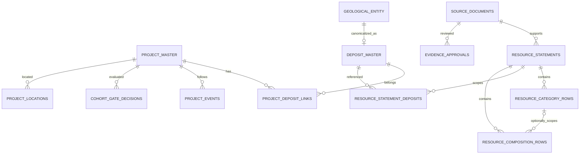

# P0.2 — Project–Deposit–JORC Resource Schema Design

**狀態：**`LOGICAL_SCHEMA_DRAFT / MIGRATION_NOT_STARTED`。此文件詳化既有 [DATA_SPECIFICATION](DATA_SPECIFICATION.md)，不新增權威實體資料庫或改動 `db/migrations/0004–0009`。**核心目的：**為 Project-based MCDA 提供不重複計算、可回溯、可按時間重建的資源與元素組成。

## 1. 以現有資料庫為基礎增量擴充

現存 `src/au_ree/core.py` 已有 `project_master`、`project_aliases`、`observations`、`source_documents`、`evidence_approvals`、`project_coordinates`、`gis_metrics`；`db/migrations/0004_scheme_a.sql` 有 `geological_entity`、`project_geological_relation`；`0005–0009` 有 Tenement/Company、Census review、Candidate gates。

**整合原則：**
- `project_master.project_id` 為正式 Project 主鍵，不重新依字串產生新權威 ID。
- 新 `deposit_master` 必須指向既有 `geological_entity.entity_id` 或保存 `source_entity_id`、審核狀態。未經核准的 `PRJ-...` review group ID **不能直接取代** `project_master.project_id`。
- 現有 `project_geological_relation` 不刪除；由 migration 提供 entity → Deposit crosswalk 和有日期／來源的 `project_deposit_links`，避免雙軌關聯互相矛盾。
- 先在 staging 產生可重算 views／版本化衍生值，再在通過 gate 後發布正式 `criteria_values`。

## 2. 邏輯 ER Diagram（不是既有程式 schema）

## 3. 欄位與關聯（候選物理規格）

| Table | 必要欄位 / 關聯（主要鍵標記 PK） |
| --- | --- |
| `deposit_master` | `deposit_id PK`, `canonical_name`, `source_entity_id`, `deposit_type_code`, `identity_status`, `approved_relation_ref` |
| `project_deposit_links` | `link_id PK`, `project_id FK`, `deposit_id FK`, `relation_role`, `effective_from/to`, `publication_date`, `approval_ref` |
| `resource_statements` | `statement_id PK`, `document_id FK`, `reporting_code`, `code_edition`, `statement_type` (MINERAL_RESOURCE / ORE_RESERVE), `entity_scope`, `scope_ref`, `statement_effective_date`, `publication_date`, `cutoff_value/unit/basis`, `reporting_basis`, `competent_person_ref`, `supersedes_statement_id`, `approval_status` |
| `resource_statement_deposits` | `statement_id FK`, `deposit_id FK`, `coverage_role`, `overlap_group`, `allocation_status`；不可將所有 scope 連結都視為可加總量 |
| `resource_category_rows` | `resource_row_id PK`, `statement_id FK`, `category` (MEASURED / INDICATED / INFERRED / TOTAL), `row_role` (COMPONENT / REPORTED_TOTAL), `tonnage_mt`, `grade_value/unit/basis`, `contained_treo_reported_kt`, `raw_value`, `source_locator` |
| `resource_composition_rows` | `composition_id PK`, `statement_id FK`, `resource_row_id nullable FK`, `oxide_code`, `reported_value/unit`, `denominator_basis`, `grade_vs_recovery_context`, `source_locator`, `approval_status` |
| `project_events` | `event_id PK`, `project_id FK`, `event_type` (SCOPING/PFS/DFS/BFS/FID/CONSTRUCTION/PRODUCTION/SUSPENDED etc.), `event_effective_date`, `publication_date`, `source_id`, `approval_ref`, `event_status` (ACTUAL/PLANNED/CONDITIONAL) |
| `project_locations` | `location_id PK`, `project_id FK`, `deposit_id nullable FK`, `location_role`, `geometry`, `crs`, `accuracy`, `source_id`, `approval_ref` |
| `cohort_gate_decisions` | `snapshot_id`, `project_id`, `gate_version`, `gate_code`, `decision`, `reason`, `source_id`, `approval_ref`, `reviewed_at`；複合 PK 不依名稱 |
| `missingness_records` | `entity_type/id`, `variable`, `scope`, `reason_code`, `evidence_status`, `snapshot_id` |
| `analysis_runs` | `run_id PK`, `snapshot_id`, `code_sha`, `schema_version`, `cohort_version`, `criteria_version`, `weight_version`, `manifest_sha256`, `seed` |

非標準礦床、礦權與公司身份繼續使用既有 `geological_entity`、`census_company_entity_resolution_queue` 和 `reverse_tenement_observations` 作來源層證據；上述新增表與原表的 FK/UNIQUE 在實作的 migration PR 中依 SQLite schema 驗證後定稿。

## 4. 資源範圍、總量與氧化物基準

JORC 2012 的 Mineral Resource 信心分類為 **Inferred、Indicated、Measured**，與 **Ore Reserve** 分開。**不能同時把分項和對應 Reported Total 加總。** 礦床間加總只有在各 statement 的範圍/日期/cut-off/reporting basis 相容，且已排除重覆 Project-level total 與 Deposit-level total 時才執行。

- `reported_total` 是**驗算列**；不得再次納入 SUM。若只有 total 而無各分類，保存 total 並標記 `CATEGORY_BREAKDOWN_NOT_REPORTED`，不反推 M/I/I。
- `contained_treo_kt = resource_mt × treo_grade_pct × 10`，僅適用同一 scope 的 Mt 和 TREO 質量百分比。原始資源為 THM、monazite proportion、MzEq 或單純 REE occurrence 時，不可直接產生 TREO。
- `S1` 的 magnet REO 需保存來源所定義的 Nd/Pr/Dy/Tb **氧化物計量**、各氧化物名稱/分子式和 TREO denominator；元素量與氧化物量不得直接相加，轉換需有明確當量與 `formula_version`。
- 未確認 `JORC_CODE_EDITION` 不能預設為 2012；對每個 statement 保存原文 edition。根據 JORC 官方 2026 年更新頁，2012 Edition 仍是當時現行規範，而修訂流程持續推進，因此系統應支援未來 code edition 而不覆寫舊聲明。來源：[JORC Code](https://www.jorc.org/Default.aspx)、[JORC Code Review Update](https://www.jorc.org/code-update)。

**禁止混加的五類：**同礦床不同有效日期、同日期不同 cut-off、同 Project total 與 Deposit subtotal、Mineral Resource 與 Ore Reserve、不同化學/礦物學 reporting basis。

## 5. 時間與審核規則

`publication_date`（當時能否知道）與 `effective_date`（估算／事件適用時間）必須分開；`retrieved_at` 和 `approval_at` 另外保存。每個 `snapshot_as_of` 僅允許公開日期及事件有效日期均在截止日之前的**核准證據**進入模型。

**事件分類**必須區分：`ACTUAL` 已完成、`PLANNED` 未來計畫、`CONDITIONAL` 須條件成就。這對 pre-FID 篩選非常重要：「預計明年 FID」不能與「已宣布 FID 決定」混同。

## 6. 實作前驗收測試清單

1. 原 `project_master` 和 `geological_entity` 身分保留，`PRJ` 候選群不可未經核准直接提升。
2. `statement_id` 重複導入是 idempotent，`reported_total` 不會與 Category Row 重複計算，Resource 與 Reserve 不混加。
3. 同 scope/timing/basis 下 M/I/I components 與 total 按來源 rounding 允差對帳；無分類來源不能偽造分類。
4. oxide/element/THM/MzEq 不同 basis 未被明確核准的轉換不得發出 R1/S1。
5. `publication_date` 大於 cutoff 的資料不能進入歷史 snapshot，撤銷證據後 downstream criterion/eligibility 失效。
6. `APPROVED` 的 Project/Document/Coordinate/Layer 四組 Gate 可關聯到具體 Source/Approval IDs，正式主矩陣無重複 project_id。
7. migration 可從**凍結 v1** 還原、重跑，且舊快照/歷史 G0/R1/S1/RS 的結果語意保持不變。

**審核模板：**[JORC Resource Statement review template](../inputs/templates/jorc_resource_statement_review_template.csv)。下一個功能 PR 才能新增 SQL migrations；目前只定稿資料模型和驗收契約。