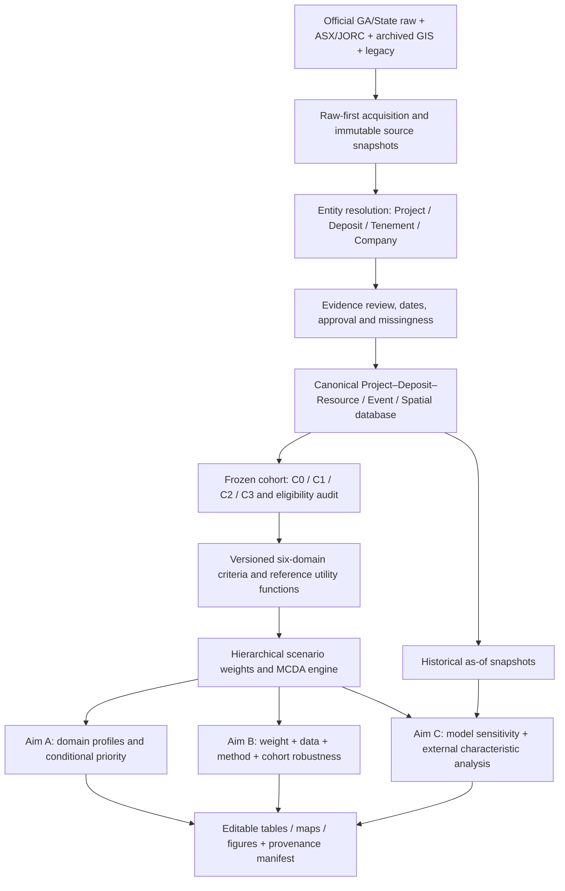

# Australian REE Research Architecture v2.0

**性質：**後續研究與開發的設計契約（design contract）  
**日期：**2026-10-31  
**狀態：**`FRAMEWORK_ADOPTED / PARAMETERS_PENDING`——研究架構與不可違反原則確立；數值門檻、主要權重、完整主母體及不確定性分布仍須經方法學審查定稿。**不代表 v2 演算法、資料庫或正式排名已實作。**

> 本文件是後續功能、資料擷取、分析和論文成果的**入口規格**。所有新增工作應先對照本文件及下列專項 Protocol；不符合者應先提出研究決策變更，再修改腳本。現有 v1.0.x snapshot、G0/R1/S1/RS 與五階段程式保持原語意，不追溯改名或重算。

## 1. 研究契約（不因功能增加而改變）

**研究單位為獨立的澳洲 REE mining/development Project**。Deposit、Prospect、Occurrence、Tenement、公司與來源文件是可追溯的從屬或關聯實體；任何原始記錄、同名或鄰近空間實體不會自行升格成 Project。

| Aim | 研究問題 | 最低可交付成果 |
| --- | --- | --- |
| **A — Development Potential** | 六構面下各 Project 的綜合表現、條件式優先順序與差異 | 六構面分數矩陣、構面圖、固定效用尺度下的主模型、清楚標記情境的排序 |
| **B — Ranking Robustness** | 權重、來源數據、排序方法及 Cohort 變更對優先順序的影響 | 分層 uncertainty runs、rank acceptability／Top-k／pairwise、方法與樣本穩健性 |
| **C — Ranking Drivers** | 模型內部敏感因子，及 Deposit Type、Lifecycle、地質／技術條件與排序的關聯 | Model-drivers、獨立外部特徵分層、D1 對照、可行時的時間外驗證 |

不得把「多準則評分」等同真實開發成功機率；不得把模型內準則對總分的機械關係敘述成地球科學因果推論。

## 2. 端到端分析流



**圖為 v2 設計目標，不表示全部完成。** 現行程式為 `population → criteria → gis → eligibility → r_export → R/run_mcda.R`。保留該執行入口，將上述資料關聯及後續研究模組以 migration／獨立分析模組整合；不要新增平行、各自不同規則的「第二份正式資料庫」。

## 3. Cohort 定義及可比性（先確立，後計分）

| Cohort | 成員與範圍 | 用途／限制 |
| --- | --- | --- |
| **C0 Census** | 原始來源＋待核查候選，保留 Project/Deposit/Occurrence/Prospect/Tenement 原類型 | 全澳覆蓋與地質／地理分布，不稱為已核准獨立 Project |
| **C1 Primary MCDA** | Australia；經核准的獨立 REE Project；Active/Under Study/Feasibility；pre-FID Scoping/PFS/DFS/BFS/Feasibility；具可比 JORC 與評分必要證據、座標/GIS 核准 | A/B/C **共同主要比較母體**；所有列使用**相同固定準則集合** |
| **C2 Extended Projects** | 身分經確認，但未滿足 C1 全部證據／準則的 Project | 探討 coverage、缺失及 Stage/Deposit Type 選取偏差；不可悄悄混入 C1 排序 |
| **C3 Historical Validation** | 能在歷史資訊截止日重建當時狀態，且有後續事件追蹤的 Project | 時間外檢驗；不使用事後才公開的證據做過去評分 |

- C1 目標是**六構面具共同準則的 RS-like cohort**；現行 `G0_BASELINE` **僅 T/D/I/C**，保留作 v1 研究基線，不能重新標示為 v2 六構面。現有 `R1_STRICT/S1_DIRECT/RS_STRICT` 是**資料可用性/納入子集**，非決策偏好。
- C1 的 **final frozen list、required criterion list、樣本日期與來源**尚待 P0 Gate 核准。若合格 Project 過少，標為 `C1_NOT_RELEASED` 並以 C2 描述 coverage；不得默默降格 C1 的資料條件來產生正式排名。
- 現行 `minimum_coverage_fraction=0.7`、`minimum_domain_count=4` 需做 selection-bias audit，並記錄從 C0→已核准 Project→C1 的各步分母、剔除原因、州別／礦床／Stage 分層。
- 無核准證據／來源矛盾／缺值不能以零分、類別平均或默認估值讓 Project 通過主研究 Gate；試驗性缺失情境必須另有 scenario ID，不能取代 C1。

詳見 [DATA_SPECIFICATION](DATA_SPECIFICATION.md) 與 [MCDA_PROTOCOL](MCDA_PROTOCOL.md)。

## 4. 評分架構：六構面、同層權重、不同研究角色

| Domain | v1 指標參考 | v2 設計決定 |
| --- | --- | --- |
| R — Resource Potential | R1 contained TREO | 保留可比 R1；原始 tonnage/grade、M/I/I 與 cut-off 作追溯/診斷，不無理由重複計分 |
| S — Strategic Composition | S1 magnet REO share | 明確氧化物集合、分母及 basis；NdPr／DyTb 絕對量另作診斷或依賴審查 |
| T — Technical Feasibility | T1 processing, T2 NORM | 明訂 ordinal 判讀 codebook 和冶金／環境證據成熟度 |
| D — Development Readiness | D1 study maturity | 主模型可包含 D1；Aim C 必須做 D1 排除模型以檢驗 Stage 的自我加分 |
| I — Infrastructure | I1–I4 straight-line distances | 「鄰近性」與接電、運輸成本、可用水量分開；空間資料版本固定 |
| C — Commercial & Regulatory Readiness（v2 建議名稱） | C1 financing, C2 offtake, C3 approvals | 目前資料不足以宣稱 ESG 總體績效；ESG 可驗證變數另行收集、之後再決定是否納入 |

**v2 名稱不追溯修改 `config/criteria.json` 的舊版 `Commercial/ESG` 標籤。** 實作時同時保存 `criteria_version` 與別名映射。

以固定效用函數 `u_j(x)` 將準則轉為有界、方向一致的值。採階層式權重：
```text
DomainScore(i,g) = Σ_j v(g,j) × u_j(x(i,j))
TotalScore(i,s)  = Σ_g W(s,g) × DomainScore(i,g)
Σ_j v(g,j) = 1 (within each domain); Σ_g W(s,g) = 1
```
決策偏好 `resource_driven`、`development_driven`、`strategic_supply_driven` 分別具可追溯、經審查的 Domain／Criterion weights；AHP 配對矩陣與每個 scenario 的關係必須是單一明確定義。主分析 SAW 採**事前固定參考尺度**作跨 cohort/年度的可比 domain score；PROMETHEE II 用事前定義的 preference function/threshold 作互補 outranking；TOPSIS 為方法敏感度檢驗，不以算法結果不一致為程式錯誤。參照 [MCDA_PROTOCOL](MCDA_PROTOCOL.md)。

## 5. Aim B/C 與可驗證性

- **B1** 權重不確定性；**B2** 來源資料不確定性及變數相依；**B3** 方法變動；**B4** cohort/eligibility 變動。各自執行，再規劃 joint uncertainty + SMAA rank acceptability；機率均帶有 cohort/model 假設條件。
- **C1** 模型內部影響：準則/構面移除、效用函數、權重、pairwise flip；**C2** 外部特徵：Deposit Type、Lifecycle Stage、礦物學、GIS、技術證據成熟度。分層比較揭露 N、缺失及不確定性，研究結論不超出關聯證據。
- D1 Included/Excluded 對照與 as-of-date 後續事件檢驗為獨立研究流程。詳見 [VALIDATION_PROTOCOL](VALIDATION_PROTOCOL.md)。

## 6. 實作次序與停止條件

| Gate | 交付與驗收 | 是否能進入下階段 |
| --- | --- | --- |
| **P0-A Cohort contract** | C0–C3 定義、C1 納入規則、批准的準則清單、各步排除原因與 coverage audit | 不完成就**不發布六構面總分** |
| **P0-B Data contract** | Project–Deposit–Resource/Evidence schema、JORC basis、缺失/時間模型、來源核准與不重複計算測試 | 不完成就**不以 derived R/S 數據排名** |
| **P1 MCDA contract** | 固定 `u_j`、Criteria Dependency Graph、構面/情境權重、AHP 實際來源、算法與一致性測試 | 不完成就**不發布研究級 Aim A** |
| **P2 B/C contract** | 數據分布與抽樣依據、相依關係、SMAA、D1 對照、分層統計及樣本數 | 不完成就**不宣稱 Aim B/C 已經驗證** |
| **P3 Historical contract** | as-of snapshot、事件定義、觀察期間、資訊洩漏測試 | 不完成就**不宣稱歷史預測力** |

[研究實施與變更流程](RESEARCH_IMPLEMENTATION_PLAN.md) 明訂 PR、資料快照、決策變更與驗收。每個功能 PR 必須對應本契約的一項 Gate；新增準則、母體、算法或命名時需更新 spec、version、tests 和 README 的「已完成／待實作」狀態。

## 7. 文件優先順序及變更管制

1. **本文件**：研究邊界、A/B/C、Gate、Cohort 角色及不變原則。
2. [DATA_SPECIFICATION](DATA_SPECIFICATION.md)：Entity、JORC、Evidence、Snapshot 等契約。
3. [MCDA_PROTOCOL](MCDA_PROTOCOL.md)：準則、效用、權重、算法之可重現定義。
4. [VALIDATION_PROTOCOL](VALIDATION_PROTOCOL.md)：Aim B/C 與時間外驗證。
5. [RESEARCH_IMPLEMENTATION_PLAN](RESEARCH_IMPLEMENTATION_PLAN.md)：交付順序、PR/QA、追蹤欄位。
6. [RESEARCH_REQUIREMENTS_AIMS_ABC](RESEARCH_REQUIREMENTS_AIMS_ABC.md)：P0–P3 詳細技術待辦與驗收清單；[RESEARCH_DECISIONS](RESEARCH_DECISIONS.md) 保留歷史決策與後續變更記錄。

**衝突處理：** v1 程式/config 是「現有實作」，本契約是「v2 目標規格」；兩者尚未遷移前不得假裝一致。若新研究結果要求偏離本契約，先在 `RESEARCH_DECISIONS.md` 記錄 proposed change、科學理由、影響的 Aim／資料／測試及核准日期，再調整規格和程式；不能直接默默修改母體與計算規則。
